<!--
  Design rules for this README:
  - every visual is a self-generated SVG committed to generated/ — no third-party
    widget services (rejected: external readme-stats services rate-limit or fail)
  - each panel ships as a dark/light <picture> pair; GitHub's camo proxy strips
    SMIL and external fonts, so animation is CSS keyframes only, inside the SVGs
  - projects are hand-picked in config.json ("projects"), never sorted purely by stars
  - if a panel's data source degrades, the build falls back to the committed
    caches in generated/ — the page goes stale, never broken
-->

<picture>
  <source media="(prefers-color-scheme: dark)" srcset="https://raw.githubusercontent.com/ItsUdoy/ItsUdoy/main/generated/dark_mode.svg" />
  <source media="(prefers-color-scheme: light)" srcset="https://raw.githubusercontent.com/ItsUdoy/ItsUdoy/main/generated/light_mode.svg" />
  
</picture>

 

$ cat about.txt

<samp>Computer Science &amp; Engineering undergraduate at Bangladesh University of Professionals (BUP), Dhaka. 
I build robust software systems, interactive games, and clean algorithmic solutions. 
C · C++ · Java · Python · TypeScript</samp>

 
 

<picture>
  <source media="(prefers-color-scheme: dark)" srcset="https://raw.githubusercontent.com/ItsUdoy/ItsUdoy/main/generated/projects_dark.svg" />
  <source media="(prefers-color-scheme: light)" srcset="https://raw.githubusercontent.com/ItsUdoy/ItsUdoy/main/generated/projects_light.svg" />
  
</picture>

<a href="https://github.com/ItsUdoy/PacMan-Game-3.5">pacman-game</a>&nbsp;&nbsp;·&nbsp;&nbsp;<a href="https://github.com/ItsUdoy/Pharmacy-Project">pharmacy-sys</a>&nbsp;&nbsp;·&nbsp;&nbsp;<a href="https://github.com/ItsUdoy/Mess-E-Billing-System">mess-ebilling</a>&nbsp;&nbsp;·&nbsp;&nbsp;<a href="https://github.com/ItsUdoy/Line-Following-Robot">lfr-robot</a>&nbsp;&nbsp;·&nbsp;&nbsp;<a href="https://github.com/ItsUdoy/Numerical-Analysis-Project">numerical-math</a>&nbsp;&nbsp;·&nbsp;&nbsp;<a href="scripts/">this profile</a>

 
 

<picture>
  <source media="(prefers-color-scheme: dark)" srcset="https://raw.githubusercontent.com/ItsUdoy/ItsUdoy/main/generated/activity_dark.svg" />
  <source media="(prefers-color-scheme: light)" srcset="https://raw.githubusercontent.com/ItsUdoy/ItsUdoy/main/generated/activity_light.svg" />
  
</picture>

 

No templates, no third-party widgets — every window above is regenerated daily by <a href=".github/workflows/build.yml">GitHub Actions</a> from <a href="scripts/">original Python</a>: ASCII portrait, dot-leader stats, heatmap, and bars are all drawn from scratch into static SVG. <a href="docs/SETUP.md">Build your own →</a>

 
 

<code>$ exit</code>&nbsp;&nbsp;—&nbsp;&nbsp;Connection to ItsUdoy@github closed. Say hi: <a href="mailto:joyhossain992@gmail.com">Email</a>&nbsp;&nbsp;·&nbsp;&nbsp;<a href="https://www.linkedin.com/in/joy-hossain-305445381/">LinkedIn</a>&nbsp;&nbsp;·&nbsp;&nbsp;<a href="https://www.facebook.com/joy.uday2017">Facebook</a>&nbsp;&nbsp;·&nbsp;&nbsp;<a href="https://www.youtube.com/@shygod9194/featured">YouTube</a>&nbsp;&nbsp;·&nbsp;&nbsp;<a href="https://wa.me/8801917357024">WhatsApp</a>

